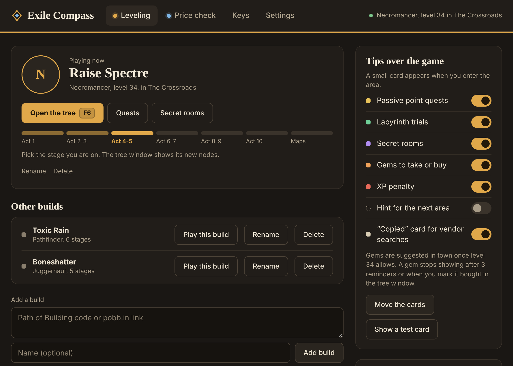
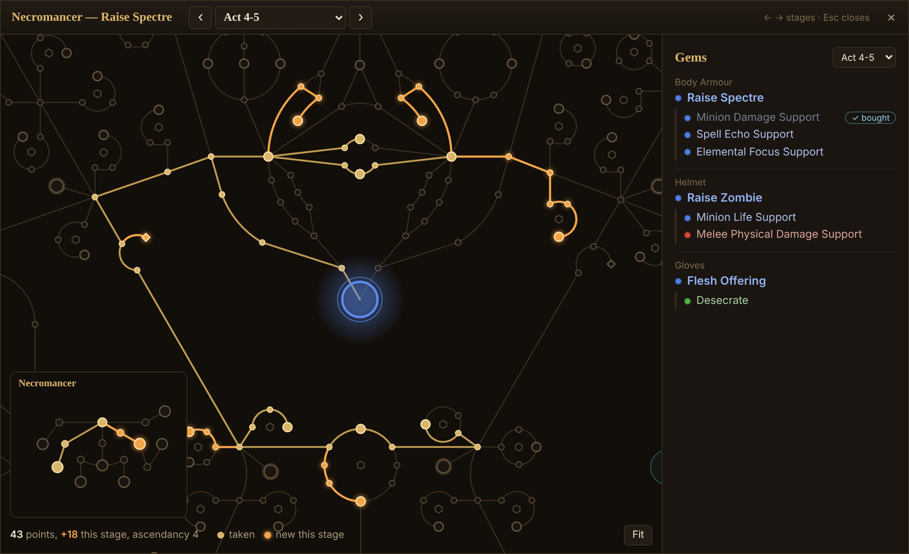
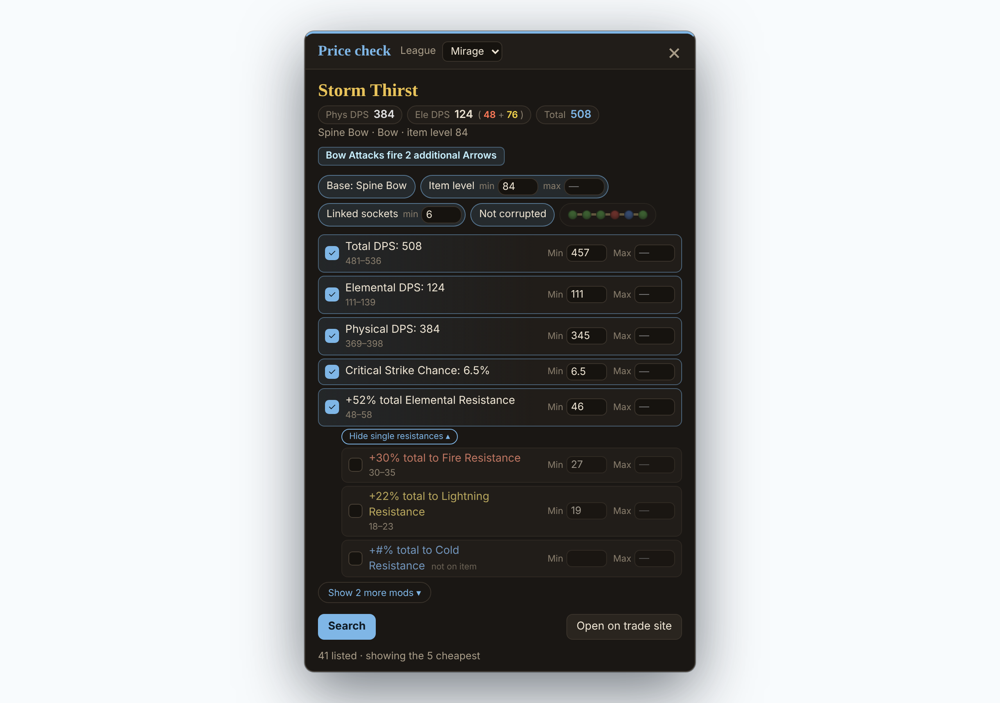

# Exile Compass

**Your Path of Exile leveling plan and a price check — right over the game.**

Passive tree for each act, gems, quests, Labyrinth trials and secret rooms from your Path of Building build.
Hover an item, press a key, see what it sells for.

## Leveling

- 🌳 **Passive tree by act** — paste a Path of Building code or a pobb.in link; every tree in the build becomes a stage (“Act 1”, “Act 2-3” …). New nodes for the stage are highlighted.
- 💎 **Gems** — the build's gem links with socket colours.
- 📜 **Quests and Labyrinth** — every quest that gives passive points and every Trial of Ascendancy, with ticks.
- 🗝️ **Secret rooms** — where they are and how to get in.
- 🔔 **Tips as you play** — a small card when you enter an area with a passive point quest, a trial or a secret room, a hint for the next area, gems to take or buy in town, and a warning when the area level costs you XP.
- 🔎 **Vendor search** — ready-made search strings for links, movement speed and +1 gem weapons for your class; one key pastes it into the vendor's search box.
- 🚪 **Relog** — one press sends `/exit`; press it again on the character select screen to enter the game.

## Price check

- ⚡ **One key** — hover an item and press `Ctrl+D`. The 10 cheapest listings from the official trade site, with the age of each listing.
- ✅ **Clear filters** — the important properties are on already; switch any of them, set **Min / Max**, press **Search**. Five properties on view, the rest behind **Show more mods**.
- 🛡️ **Resistances added up** — fire, cold and lightning in one total (hybrids and crafted ones included); a small button opens the single ones, even those the item doesn't have.
- 🏹 **Weapons at a glance** — physical and elemental DPS next to the name, extra arrows and +gem levels.
- 💎 **Gems** — level, quality and corruption of every listing.
- 🔴 **Socket colours** — one chip with the item's sockets; switch it on to search for the same colours.
- ❎ **Out of the way** — click anywhere in the game to close it; the click still reaches the game.

## And also

- 🎮 **Discord** — shows your class or ascendancy, level and area in your profile.
- ⌨️ **All keys in one place** — the Keys tab; `Ctrl+Space` opens the main window.
- 🔄 **Updates itself** — new versions install on restart.
- 📦 **Moving from PoE Act Guide or PoE Price Check?** Exile Compass takes your builds and settings on first start. Uninstall the old apps afterwards.

## Get started

1. **[Download the installer](https://github.com/1yandurask/exile-compass/releases/latest/download/Exile-Compass-Setup.exe)** and run it. Windows may say *“Windows protected your PC”* — click **More info → Run anyway** (the app is not code-signed).
2. In Path of Exile set **Options → Graphics → Display Mode → Windowed Fullscreen** — windows can't draw over exclusive fullscreen.
3. Paste your Path of Building code or a pobb.in link, pick the league for prices, and play.

Prefer no installer? Grab the **[portable version](https://github.com/1yandurask/exile-compass/releases/latest/download/Exile-Compass-Portable.exe)** — one file, runs from anywhere, but doesn't update itself.

## Keys

| Key | What it does |
|:---:|---|
| `F6` | Passive tree and gems |
| `F7` | Quests and Labyrinth trials |
| `F8` | Secret rooms |
| `F9` | Vendor search strings |
| `F10` | Paste the selected search into the vendor's search box |
| `Ctrl+D` | Price check the item under the cursor |
| `Ctrl+Space` | Open Exile Compass |
| — | Relog: `/exit`, then press again to enter the game (set your own key) |
| `Esc` | Close any open window |

All of them can be changed on the Keys tab.

## Good to know

- Windows 10 / 11, Path of Exile 1, English game client for the price check. Free, no account, no sign-in.
- It reads the game's log file and sends a key to the game only when you press one of its keys. It never touches the game client, its memory or its network traffic.
- Prices are what players list on the trade site — check twice before you buy.

[All releases](https://github.com/1yandurask/exile-compass/releases) · [Report a problem](https://github.com/1yandurask/exile-compass/issues) · [Terms of Service](TERMS.md) · [Privacy Policy](PRIVACY.md)

Passive tree data from GGG's official export. Gem colours from Path of Building Community (MIT). Gem vendors, quest rewards and area map from Exile-Leveling (MIT). Item parsing from Awakened PoE Trade (MIT). Prices from pathofexile.com and poe.ninja. 
Exile Compass is not affiliated with or endorsed by Grinding Gear Games.

